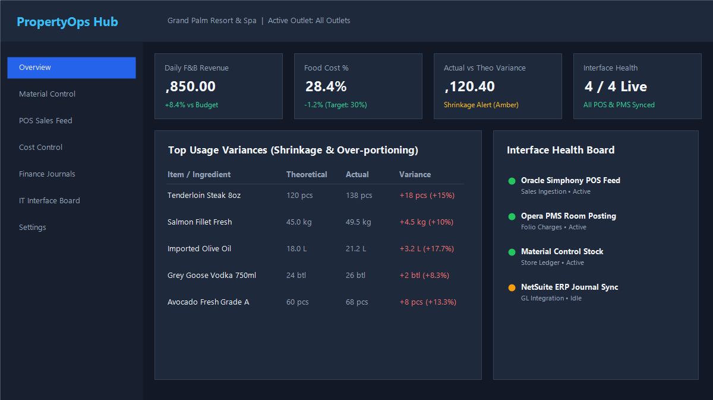

# PropertyOps Hub

A multi-unit hospitality operations platform: **material control**, **POS sales ingestion**, **cost-of-sales analysis**, **ERP-ready journal export** and **IT interface monitoring**, built with **.NET 10** and **Angular**.

> Designed from real-world hotel and restaurant IT experience: Oracle POS, PMS and Material Control, plus ERP implementations (Oracle, NetSuite, Sun Systems) across multiple business units, and running the IT department that kept them all talking.



---

## Table of contents

1. [Why this exists](#why-this-exists)
2. [Features](#features)
3. [Architecture](#architecture)
4. [Tech stack](#tech-stack)
5. [Repository structure](#repository-structure)
6. [Domain model and business rules](#domain-model-and-business-rules)
7. [Getting started](#getting-started)
8. [Scaffold commands](#scaffold-commands)
9. [Testing](#testing)
10. [Implementation plan](#implementation-plan)
11. [Key design decisions](#key-design-decisions)
12. [Roadmap](#roadmap)
13. [About](#about)

---

## Why this exists

Hospitality groups run several systems per property (POS, PMS, inventory, ERP) that rarely agree with each other. PropertyOps Hub is the layer in between:

- One view of stock, cost and sales across **Group → Property → Outlet**
- **Theoretical vs actual usage**, so shrinkage, waste and over-portioning are visible
- **Balanced, auditable journal batches** that finance can post to an ERP
- An **interface health board**, so IT knows a POS/PMS/ERP link is down before finance does

---

## Features

| Area | Highlights |
|---|---|
| Multi-unit tenancy | Group/Property/Outlet hierarchy, per-property data isolation, role-based access |
| Material control | Items, UoM conversions, recipes/BOM, suppliers, PO → GRN, stock counts, wastage, weighted average cost |
| Sales ingestion | POS check import (simulated/CSV), idempotent, validation of voids, discounts and tenders |
| PMS bridge | Simulated room-charge postings from POS to folio, with retry and reconciliation |
| Cost control | Theoretical vs actual usage, variance thresholds, food cost % |
| Finance export | GL and cost-centre mapping, balanced journals, reversal entries, CSV/JSON export (NetSuite/Sun style) |
| IT operations | Interface registry, live health board (SignalR), incident tickets, user access reviews |
| Dashboards | Daily flash report, variance top-N, cost trends |

---

## Architecture

Clean Architecture with light CQRS.

```
Web (Angular) → Api → Application → Domain
                  ↘ Infrastructure ↗
```

- **Domain**: entities, value objects, business rules. No framework dependencies.
- **Application**: use cases (MediatR handlers), validation, abstractions, pipeline behaviours.
- **Infrastructure**: EF Core, Identity, Hangfire, integrations, outbox.
- **Api**: controllers, SignalR hubs, middleware, composition root.

See [docs/architecture.md](docs/architecture.md) and the [ADRs](docs/adr) for decisions on tenancy, idempotent posting and the outbox.

---

## Tech stack

| Layer | Choice |
|---|---|
| API | .NET 10 Web API, C# 14 |
| Architecture | Clean Architecture, MediatR (light CQRS) |
| Data | EF Core + SQL Server (Docker); Dapper for heavy reports |
| Validation | FluentValidation |
| Background jobs | Hangfire (SQL storage) |
| Realtime | SignalR |
| Auth | ASP.NET Identity + JWT + refresh tokens; role and policy based |
| Messaging | Transactional outbox; RabbitMQ optional |
| Observability | Serilog + OpenTelemetry |
| API docs | OpenAPI + Scalar |
| Frontend | Angular (standalone components, signals, lazy routes), Angular Material, ngx-charts |
| Tests | xUnit, FluentAssertions, Testcontainers, Jasmine/Jest, Playwright |
| DevOps | Docker Compose, GitHub Actions |

> **Adapting to a job description:** swap SQL Server for PostgreSQL or Oracle (ODP.NET), Hangfire for Quartz/Azure Functions, JWT for OIDC/Azure AD, or add NgRx on the frontend. The layering stays the same.

---

## Repository structure

```
propertyops-hub/
├── README.md
├── LICENSE
├── .editorconfig
├── .gitignore
├── Directory.Build.props
├── Directory.Packages.props          # central package management
├── global.json
├── PropertyOpsHub.sln
├── docker-compose.yml
├── docker-compose.override.yml
│
├── docs/
│   ├── architecture.md
│   ├── domain-glossary.md            # POS, PMS, GRN, UoM, BOM, COGS...
│   ├── erd.png
│   ├── adr/
│   │   ├── 0001-clean-architecture.md
│   │   ├── 0002-multi-tenancy-strategy.md
│   │   ├── 0003-idempotent-journal-posting.md
│   │   └── 0004-outbox-pattern.md
│   ├── api/                          # exported OpenAPI
│   └── screenshots/
│
├── src/
│   ├── PropertyOpsHub.Domain/
│   │   ├── Common/                   # Entity, AggregateRoot, ValueObject, IDomainEvent
│   │   ├── Organization/             # Group, Property, Outlet
│   │   ├── MaterialControl/          # Item, UnitOfMeasure, UomConversion, Recipe,
│   │   │                             # PurchaseOrder, GoodsReceipt, StockCount,
│   │   │                             # StockMovement, WastageRecord
│   │   ├── Sales/                    # SalesCheck, SalesLine, Tender, RevenueCenter
│   │   ├── Finance/                  # GlAccount, CostCenter, MappingRule,
│   │   │                             # JournalBatch, JournalLine
│   │   ├── ItOps/                    # Interface, InterfaceHealthLog, Incident, AccessReview
│   │   └── Exceptions/
│   │
│   ├── PropertyOpsHub.Application/
│   │   ├── Abstractions/             # IAppDbContext, IClock, ICurrentUser, IPosAdapter
│   │   ├── Behaviors/                # Validation, Logging, Transaction pipeline
│   │   ├── Features/
│   │   │   ├── Auth/
│   │   │   ├── Organization/
│   │   │   ├── MaterialControl/
│   │   │   │   ├── Items/
│   │   │   │   ├── Recipes/
│   │   │   │   ├── PurchaseOrders/
│   │   │   │   ├── GoodsReceipts/
│   │   │   │   └── StockCounts/
│   │   │   ├── Sales/
│   │   │   ├── CostControl/          # theoretical vs actual usage
│   │   │   ├── Finance/              # mapping + journal generation
│   │   │   ├── ItOps/
│   │   │   └── Dashboards/
│   │   └── DependencyInjection.cs
│   │
│   ├── PropertyOpsHub.Infrastructure/
│   │   ├── Persistence/
│   │   │   ├── AppDbContext.cs
│   │   │   ├── Configurations/       # IEntityTypeConfiguration<T>
│   │   │   ├── Migrations/
│   │   │   ├── Interceptors/         # audit fields, soft delete, domain events
│   │   │   └── Seed/
│   │   ├── Identity/
│   │   ├── Integrations/
│   │   │   ├── Pos/                  # SimulatedPosAdapter, CsvPosAdapter
│   │   │   ├── Pms/                  # SimulatedPmsClient
│   │   │   └── Erp/                  # CsvJournalExporter, NetSuiteStyleJsonExporter
│   │   ├── Jobs/                     # Hangfire jobs
│   │   ├── Outbox/
│   │   └── DependencyInjection.cs
│   │
│   ├── PropertyOpsHub.Api/
│   │   ├── Controllers/
│   │   ├── Hubs/                     # InterfaceHealthHub
│   │   ├── Middleware/               # ProblemDetails, tenant resolution, correlation id
│   │   ├── Program.cs
│   │   └── appsettings*.json
│   │
│   └── PropertyOpsHub.Web/           # Angular workspace
│       ├── angular.json
│       ├── package.json
│       └── src/app/
│           ├── core/                 # auth, interceptors, guards, api clients, signalr
│           ├── shared/               # ui components, pipes, directives
│           ├── layout/               # shell, sidebar, property switcher
│           └── features/
│               ├── auth/
│               ├── dashboard/
│               ├── material-control/ # items, recipes, po, grn, stock-count
│               ├── sales/
│               ├── cost-control/
│               ├── finance/
│               └── it-ops/
│
├── tools/
│   └── PropertyOpsHub.DataGenerator/ # fake POS/PMS data console app
│
├── tests/
│   ├── PropertyOpsHub.Domain.Tests/
│   ├── PropertyOpsHub.Application.Tests/
│   ├── PropertyOpsHub.Api.IntegrationTests/   # Testcontainers SQL Server
│   └── e2e/                                    # Playwright
│
└── .github/
    └── workflows/
        ├── ci.yml                    # build, test, lint
        └── docker.yml
```

---

## Domain model and business rules

### Core entities (Material Control)

| Entity | Purpose |
|---|---|
| `Item` | Stock item with category, base UoM, and costing method |
| `UnitOfMeasure` | kg, g, L, ml, each, case... |
| `UomConversion` | Item-specific conversion (1 case = 12 × 1 kg; 1 kg = 1000 g) |
| `Recipe` / `RecipeLine` | Menu item BOM: ingredient, quantity, yield/waste % |
| `PurchaseOrder` / `PoLine` | Supplier order, status workflow |
| `GoodsReceipt` / `GrnLine` | Receipt against a PO, updates cost and stock |
| `StockMovement` | Append-only ledger of every stock change |
| `StockCount` | Periodic count with variance against book stock |
| `WastageRecord` | Spoilage, breakage, staff meals, with reason codes |

### Rules

1. **UoM conversion**: items are purchased in cases, stocked in kg, issued in grams. Conversions are defined per item.
2. **Weighted average cost** is recalculated on each GRN. Stock movements are append-only (a ledger, not an editable balance).
3. **Theoretical usage** = Σ(menu item sold × recipe quantity). **Actual usage** = opening + purchases − closing − transfers. **Variance** = actual − theoretical, with a configurable threshold alert.
4. **Journal rules**: every batch must balance (debits = credits). Each batch has a deterministic idempotency key (`property + business date + type`), so re-running a day never double-posts. Posted batches are immutable; corrections are reversing entries.
5. **Tenancy**: every tenant-owned row carries `PropertyId`, enforced by EF Core global query filters plus a policy check on the user's property claims.
6. **Interface health**: each integration has an expected sync interval; a job marks it Green/Amber/Red and pushes changes over SignalR.

### Roles

| Role | Scope |
|---|---|
| Group Finance | All properties: journals, mappings, consolidated reports |
| Property GM | Own property: dashboards, variance, approvals |
| Store Controller | Own property: material control, counts, GRN |
| IT Admin | Interfaces, incidents, access reviews, user management |

---

## Getting started

### Prerequisites
.NET 10 SDK, Node 22+, Docker Desktop

### Run everything
```bash
git clone https://github.com/<you>/propertyops-hub.git
cd propertyops-hub
docker compose up -d          # SQL Server
dotnet run --project src/PropertyOpsHub.Api
cd src/PropertyOpsHub.Web && npm install && npm start
```

- API docs: https://localhost:5001/scalar
- Web: http://localhost:4200
- Hangfire dashboard: https://localhost:5001/hangfire

### Seed demo data
```bash
dotnet run --project tools/PropertyOpsHub.DataGenerator -- --days 30 --properties 3
```

### Demo users

| Role | Email | Password |
|---|---|---|
| Group Finance | finance@demo.local | `Demo#12345` |
| Property GM | gm@demo.local | `Demo#12345` |
| Store Controller | store@demo.local | `Demo#12345` |
| IT Admin | it@demo.local | `Demo#12345` |

### Example `docker-compose.yml`
```yaml
services:
  sqlserver:
    image: mcr.microsoft.com/mssql/server:2022-latest
    environment:
      ACCEPT_EULA: "Y"
      MSSQL_SA_PASSWORD: "Your_strong_Passw0rd"
    ports:
      - "1433:1433"
    volumes:
      - sqldata:/var/opt/mssql
volumes:
  sqldata:
```

---

## Scaffold commands

Run from an empty `propertyops-hub` folder (PowerShell or bash):

```bash
dotnet new sln -n PropertyOpsHub
dotnet new gitignore
dotnet new editorconfig
dotnet new globaljson

# Source projects
dotnet new classlib -n PropertyOpsHub.Domain         -o src/PropertyOpsHub.Domain
dotnet new classlib -n PropertyOpsHub.Application    -o src/PropertyOpsHub.Application
dotnet new classlib -n PropertyOpsHub.Infrastructure -o src/PropertyOpsHub.Infrastructure
dotnet new webapi   -n PropertyOpsHub.Api            -o src/PropertyOpsHub.Api --use-controllers

# Tools and tests
dotnet new console  -n PropertyOpsHub.DataGenerator  -o tools/PropertyOpsHub.DataGenerator
dotnet new xunit    -n PropertyOpsHub.Domain.Tests          -o tests/PropertyOpsHub.Domain.Tests
dotnet new xunit    -n PropertyOpsHub.Application.Tests     -o tests/PropertyOpsHub.Application.Tests
dotnet new xunit    -n PropertyOpsHub.Api.IntegrationTests  -o tests/PropertyOpsHub.Api.IntegrationTests

# Add everything to the solution
dotnet sln add (Get-ChildItem -Recurse -Filter *.csproj)    # PowerShell
# bash alternative: dotnet sln add $(find . -name "*.csproj")

# Project references (dependencies point inward)
dotnet add src/PropertyOpsHub.Application reference src/PropertyOpsHub.Domain
dotnet add src/PropertyOpsHub.Infrastructure reference src/PropertyOpsHub.Application
dotnet add src/PropertyOpsHub.Api reference src/PropertyOpsHub.Application src/PropertyOpsHub.Infrastructure
dotnet add tests/PropertyOpsHub.Domain.Tests reference src/PropertyOpsHub.Domain
dotnet add tests/PropertyOpsHub.Application.Tests reference src/PropertyOpsHub.Application
dotnet add tests/PropertyOpsHub.Api.IntegrationTests reference src/PropertyOpsHub.Api
dotnet add tools/PropertyOpsHub.DataGenerator reference src/PropertyOpsHub.Application

# Angular workspace
npm install -g @angular/cli
ng new PropertyOpsHub.Web --directory src/PropertyOpsHub.Web --standalone --routing --style=scss
```

> Package names and the Angular CLI flags change between releases; check `dotnet add package --help` and `ng new --help` if a command is rejected.

---

## Testing

```bash
dotnet test                              # unit + integration (Testcontainers)
cd src/PropertyOpsHub.Web && npm test    # Angular unit tests
npx playwright test                      # e2e
```

Priorities for test coverage:

- UoM conversion and weighted average cost maths (pure domain tests)
- Variance calculation against seeded scenarios
- Journal balancing and idempotency
- Cross-tenant access is rejected (integration tests)

---

## Implementation plan

| Phase | Duration | Deliverable | Done when |
|---|---|---|---|
| 0. Setup | 2 days | Solution, CI, Docker Compose, SQL Server, Angular shell | `docker compose up` runs the DB, API starts, CI is green |
| 1. Foundation | 1 week | Identity, JWT, roles, Group/Property/Outlet, tenant filters, Angular login and property switcher | Role-based nav works; cross-tenant access blocked by tests |
| 2. Material Control I | 1.5 weeks | Items, UoM and conversions, suppliers, recipes | CRUD, validation and unit tests on conversion maths |
| 3. Material Control II | 1.5 weeks | PO → GRN → stock ledger, stock counts, wastage | Weighted average cost verified by tests |
| 4. Sales ingestion | 1 week | Data generator, import endpoint/job, idempotent check import | Re-importing the same file creates no duplicates |
| 5. Cost control | 1 week | Theoretical vs actual, variance report, alerts | Seeded scenario produces the expected variance |
| 6. Finance export | 1.5 weeks | GL/cost-centre mapping, journal batches, CSV/JSON export, reversal | Batch balances; idempotency proven by test |
| 7. IT Ops | 1 week | Interface registry, health job, SignalR board, incidents, access review | Board updates live when a sync is stopped |
| 8. Dashboards | 4 days | Daily flash, food cost %, variance top-N | Charts driven by real queries |
| 9. Hardening | 1 week | Integration tests, a few Playwright flows, logging/OTel, Docker images, README and screenshots | CI runs all tests; a clean clone runs with one command |

**Total: roughly 10-11 weeks part-time.** To trim, cut phases 7-8 down to an MVP.

Workflow tips: branch per feature, open PRs even when working solo, and write meaningful commit messages. The Git history is part of the portfolio.

### First coding session checklist

1. Create `Entity`, `AggregateRoot` and `ValueObject` base types in `Domain/Common`
2. Model `Item`, `UnitOfMeasure` and `UomConversion` with a `Convert(quantity, from, to)` method
3. Write xUnit tests for conversions first (case → kg → g, round-trips, invalid paths)
4. Add `AppDbContext` and `IEntityTypeConfiguration<T>` for these entities
5. Add the first migration and an `Items` controller with validation
6. Generate the Angular `items` feature with a list and a form

---

## Key design decisions

- **Idempotent journals**: each batch has a deterministic key (`property + business date + type`); re-running never double-posts.
- **Append-only stock ledger**: balances are derived, never edited.
- **Tenant isolation**: EF Core global query filters plus claims-based policies, verified by integration tests.
- **Corrections by reversal**: posted batches are immutable, mirroring real finance controls.
- **Adapters for integrations**: POS, PMS and ERP sit behind interfaces, so simulated adapters can be swapped for real ones.

---

## Roadmap

- [ ] Real POS/PMS adapter samples
- [ ] RabbitMQ transport for the outbox
- [ ] Multi-currency and tax handling
- [ ] Azure/AWS deployment with infrastructure as code
- [ ] Audit log viewer and period-close controls

---

## About

Built by **<Your Name>**, IT and systems manager with hands-on experience in Oracle (POS, PMS, Material Control), NetSuite and Sun Systems implementations in multi-unit hospitality, leading IT teams and system rollouts.

<LinkedIn> · <Email>

## License

MIT
# PropertyOps-Hub
