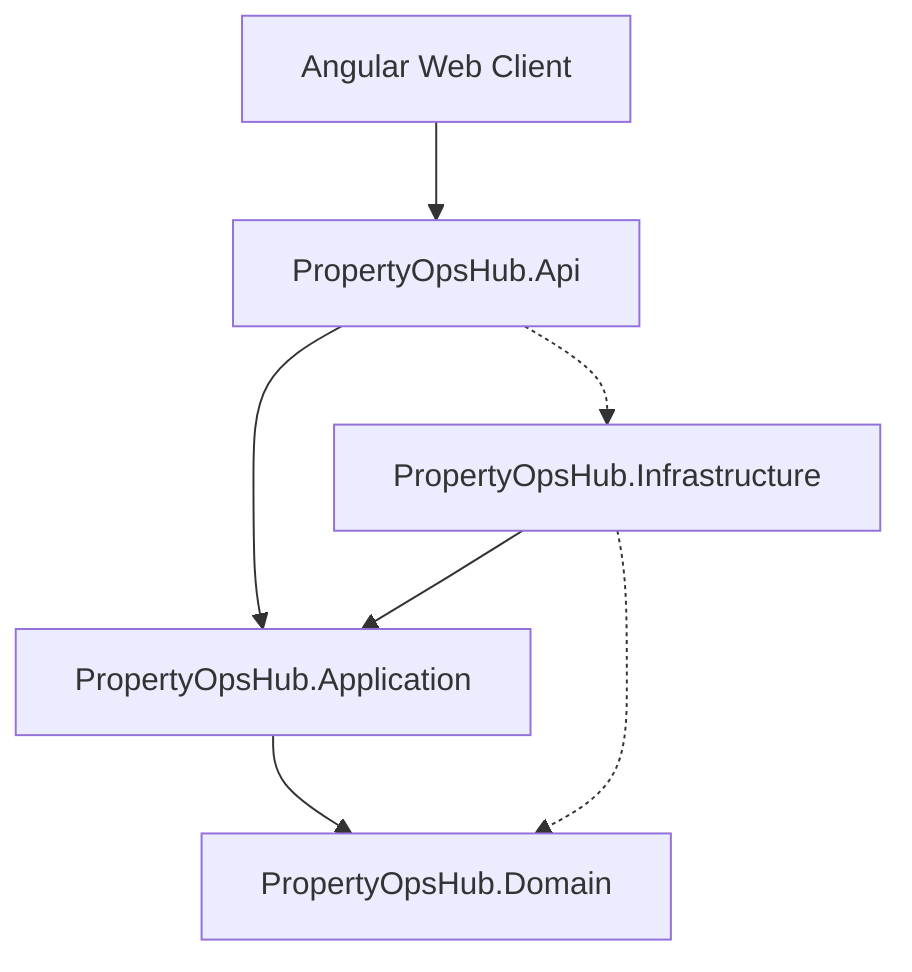

# ADR 0001: Adoption of Clean Architecture and Light CQRS

## Status
Accepted

## Context
Hospitality operations platforms interface with diverse, heterogeneous systems:
- Real-time Point of Sale (POS) terminals streaming checks, discounts, and item voids.
- Property Management Systems (PMS) expecting immediate room charge settlements.
- Inventory warehouses with high-frequency stock movements and UoM conversions.
- Corporate ERP back-offices requiring immutable, balanced accounting journals.

Without clear architectural boundaries, business rules such as recipe yield loss, UoM conversion trees, and weighted average costing become entangled with persistence models, background schedulers, and third-party API adapters.

## Decision
We adopt **Clean Architecture** with inward-pointing dependencies, accompanied by **Light CQRS** using `MediatR` and `FluentValidation`:

1. **Domain Layer**: Houses pure business entities (`Item`, `Recipe`, `SalesCheck`, `JournalBatch`), value objects, domain exceptions, and domain events. It has zero external dependencies on frameworks, databases, or UI.
2. **Application Layer**: Contains distinct Command and Query handlers (`IRequest<T>`), validation pipeline behaviors, and port abstractions (`IAppDbContext`, `IPosAdapter`, `IPmsClient`).
3. **Infrastructure Layer**: Implements external ports with Entity Framework Core, Dapper (for high-performance reporting queries), Hangfire for durable jobs, ASP.NET Core Identity, and integrations.
4. **Api Layer**: Focuses on HTTP entry points, authentication middleware, multi-tenant resolution, and SignalR hubs.

## Consequences

### Positive
- **Testability**: Domain logic (such as recipe portion costing and UoM conversions) can be unit-tested without databases or web servers.
- **Maintainability & Portability**: Upstream POS adapters or downstream ERP export formats can change without altering domain calculations or application handlers.
- **Clean Separation of Concerns**: Queries can utilize optimized Dapper views while commands operate through rich EF Core aggregates.

### Trade-offs
- More boilerplate classes (Requests, Handlers, Validators, DTOs).
- Requires strict discipline to prevent domain logic leakage into controllers or infrastructure repositories.
