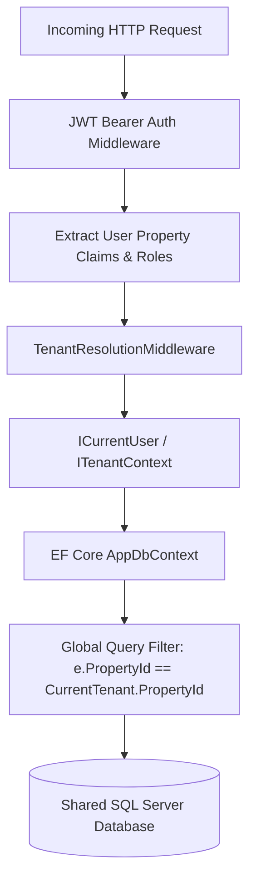

# ADR 0002: Multi-Tenancy Strategy (Group → Property → Outlet)

## Status
Accepted

## Context
Hospitality management groups operate multiple hotel properties (e.g., Resort, City Hotel, Conference Center), each containing distinct revenue and cost centers (Outlets like Fine Dining, Pool Bar, Room Service). 

Key tenancy requirements:
1. Operational data (sales checks, inventory movements, recipes, stock counts) must remain strictly isolated between properties.
2. Group-level executives (Group Finance, Chief Commercial Officer) require cross-property visibility and consolidated reporting.
3. Property-level staff (Store Controllers, Property GMs) must only access data within their assigned property.
4. Infrastructure and hosting must remain cost-efficient without provisioning distinct databases per property.

## Decision
We implement a **shared-database, discriminator-column multi-tenancy model** using **EF Core Global Query Filters** and **Claims-Based Authorization**:



### Implementation Details:
1. **Tenant Discriminator**: All tenant-scoped entities implement `ITenantEntity` containing `Guid PropertyId { get; set; }`.
2. **EF Core Global Query Filters**:
   ```csharp
   modelBuilder.Entity<T>()
       .HasQueryFilter(e => _currentUser.IsGroupAdmin || e.PropertyId == _currentUser.PropertyId);
   ```
3. **Claims Enforcement**: During authentication, the user's JWT token contains `property_id` and assigned `outlet_ids`. Requests attempting to access or modify records belonging to other properties are rejected with `403 Forbidden`.
4. **Group Admin Bypass**: Group-level roles can explicitly specify a target `PropertyId` header or query parameter to aggregate or drill into specific property metrics.

## Consequences

### Positive
- Cost-effective single-database deployment with zero operational overhead per new property.
- Prevents accidental cross-tenant data leakage by automatically applying query filters across all LINQ queries.
- Easy consolidation reporting for Group Finance.

### Trade-offs
- Requires care with background jobs (Hangfire) to explicitly supply the execution tenant context.
- Indexing must always consider `PropertyId` as the leading column in composite indexes for query performance.
