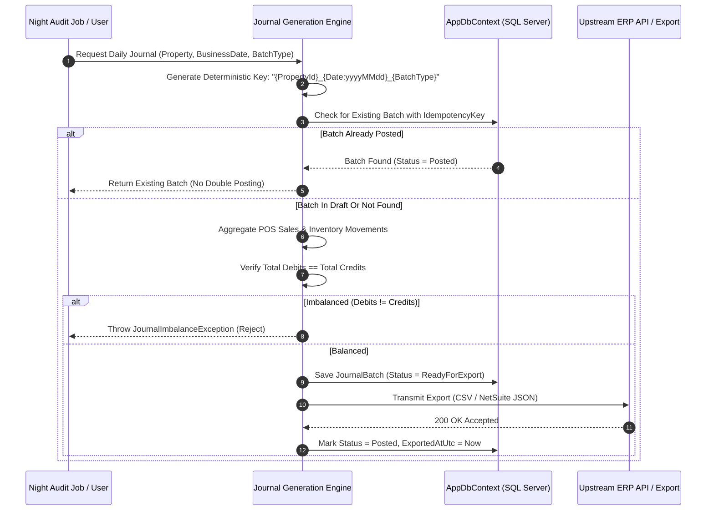

# ADR 0003: Idempotent Journal Posting and Double-Entry Balancing

## Status
Accepted

## Context
At hotel night audit or financial month-end, daily sales summaries, material receipts, and inventory consumption must be summarized and exported to general ledger ERPs (such as Oracle Financials, NetSuite, or Sun Systems).

Network timeouts, manual retries, or re-running night audits can cause catastrophic double-posting of financial revenue and inventory adjustments. Furthermore, any exported batch that violates the fundamental accounting equation ($\sum \text{Debits} \ne \sum \text{Credits}$) results in immediate ERP rejection or audit non-compliance.

## Decision
We enforce **Deterministic Idempotency Keys** and **Strict In-Memory & DB-Level Balance Verification**:

### Business Rules:
1. **Deterministic Idempotency Key**:
   $$\text{IdempotencyKey} = \text{PropertyId} + \text{"::"} + \text{BusinessDate (yyyy-MM-dd)} + \text{"::"} + \text{BatchType}$$
   A unique index is enforced on `JournalBatch.IdempotencyKey` in SQL Server.
2. **Double-Entry Balance Guarantee**:
   Before persistence, the aggregate root asserts `Math.Abs(Lines.Sum(l => l.Debit) - Lines.Sum(l => l.Credit)) < 0.0001m`. Imbalanced batches are aborted immediately.
3. **Immutability & Correction by Reversal**:
   Once a `JournalBatch` transitions to `Posted`, it is immutable. Errors cannot be updated or deleted. Corrections require generating a distinct reversing entry (`BatchType = Reversal`) referencing the original batch ID.

## Consequences

### Positive
- Guarantees zero duplicate postings across automated retries or user clicks.
- Eliminates ERP integration rejections due to out-of-balance debits and credits.
- Provides complete audit trail required by internal and external financial controllers.

### Trade-offs
- Adjustments require generating dedicated reversal batches rather than editing lines in place.
