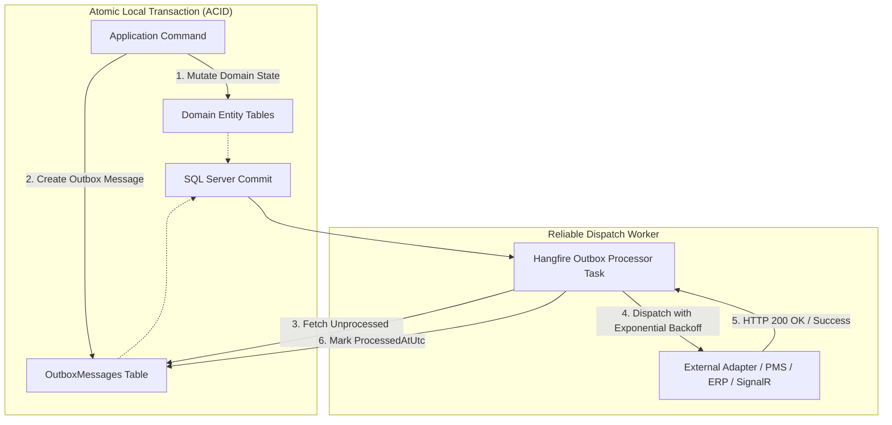

# ADR 0004: Transactional Outbox Pattern for Asynchronous Integration

## Status
Accepted

## Context
PropertyOps Hub integrates with multiple external and third-party systems:
- POS sales check feeds (import)
- PMS room-charge guest folio posting (export/sync)
- Corporate ERP general ledger journals (export)
- IT operations real-time alert broadcasts (SignalR & incident triggers)

If an operation updates the local database (e.g. saves an ingested POS check) and immediately makes an HTTP/network call to an external PMS or ERP, a network partition, remote 500 error, or local server crash can cause dual-write inconsistency:
- Database transaction commits, but the external call fails (message lost).
- External call succeeds, but the database transaction fails to commit (phantom record).

Distributed 2PC (Two-Phase Commit) protocols are slow, fragile, and not supported by third-party SaaS APIs.

## Decision
We adopt the **Transactional Outbox Pattern** with **Hangfire Background Job Dispatching**:

### Outbox Schema Details:
- `Id`: Unique GUID
- `PropertyId`: Tenant isolation key
- `EventType`: e.g. `Pms.FolioChargeRequested`, `Erp.JournalBatchReady`, `ItOps.InterfaceAlertTriggered`
- `Payload`: Serialized JSON payload
- `OccurredOnUtc`: Timestamp of creation
- `ProcessedOnUtc`: Nullable timestamp when dispatched
- `RetryCount`: Incremented on dispatch failure
- `Error`: Error message if last retry failed

## Consequences

### Positive
- **Guaranteed At-Least-Once Delivery**: No integration message is lost even if downstream APIs or network links are temporarily offline.
- **Zero Distributed Locks**: Keeps core database transactions fast, minimal, and non-blocking.
- **Auditable History**: Outbox logs provide transparency into what events were dispatched and when.

### Trade-offs
- Downstream endpoints must be idempotent to handle potential duplicates (At-Least-Once).
- Slight eventual consistency delay (typically under 1-2 seconds) between local commit and external transmission.
