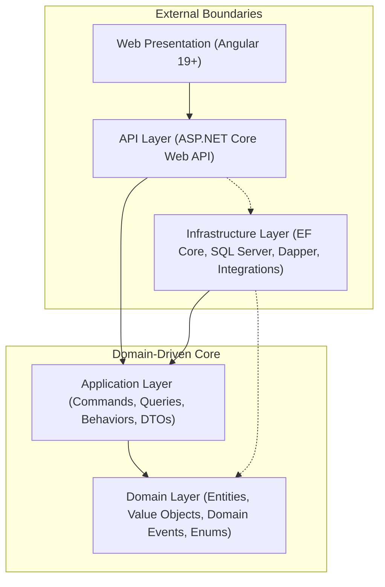
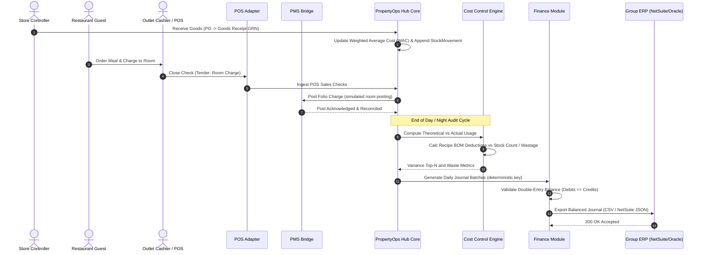
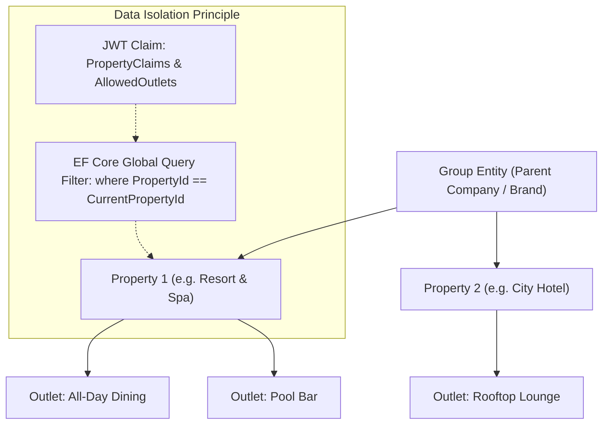
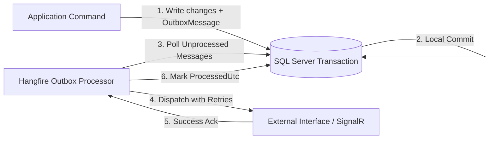
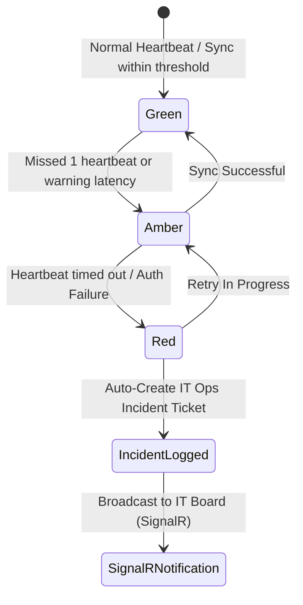

# PropertyOps Hub - Architecture Specification

## Overview

**PropertyOps Hub** is an enterprise-grade multi-unit hospitality operations platform designed to bridge the operational divide between Point of Sale (POS), Property Management Systems (PMS), Material Control / Inventory, and back-office Enterprise Resource Planning (ERP) accounting engines.

The application follows **Clean Architecture** principles and a **Light CQRS** pattern, decoupled via `MediatR` and validated by `FluentValidation`.

---

## Architectural Layers

### 1. Domain Layer (`PropertyOpsHub.Domain`)
The core domain logic, enterprise rules, and model definitions. Free from external libraries or frameworks (except lightweight primitives).
- **Common**: `Entity`, `AggregateRoot`, `ValueObject`, `IDomainEvent`
- **Organization**: `Group`, `Property`, `Outlet`
- **MaterialControl**: `Item`, `UnitOfMeasure`, `UomConversion`, `Recipe`, `PurchaseOrder`, `GoodsReceipt`, `StockCount`, `StockMovement`, `WastageRecord`
- **Sales**: `SalesCheck`, `SalesLine`, `Tender`, `RevenueCenter`
- **Finance**: `GlAccount`, `CostCenter`, `MappingRule`, `JournalBatch`, `JournalLine`
- **ItOps**: `Interface`, `InterfaceHealthLog`, `Incident`, `AccessReview`

### 2. Application Layer (`PropertyOpsHub.Application`)
Orchestrates business use cases using CQRS.
- Command Handlers, Query Handlers, and Pipeline Behaviors (Logging, Validation, Transaction).
- Port interfaces (`IAppDbContext`, `ICurrentUser`, `IPosAdapter`, `IPmsClient`, `IErpJournalExporter`).

### 3. Infrastructure Layer (`PropertyOpsHub.Infrastructure`)
Adapters for persistence, external interfaces, and platform capabilities.
- **Persistence**: EF Core with SQL Server 2022, Dapper read models, configurations, interceptors (Audit, Soft Delete, Outbox).
- **Identity & Auth**: ASP.NET Core Identity, JWT authentication with refresh tokens, claims-based authorization.
- **Integrations**: `SimulatedPosAdapter`, `CsvPosAdapter`, `SimulatedPmsClient`, `CsvJournalExporter`, `NetSuiteJsonExporter`.
- **Background Jobs**: Hangfire scheduler with persistent SQL storage.

### 4. API Layer (`PropertyOpsHub.Api`)
Host and composition root for HTTP and WebSocket communication.
- Controllers, SignalR Hubs (`InterfaceHealthHub`).
- Global Exception Handler (RFC 7807 ProblemDetails), Multi-Tenant Resolution Middleware, OpenTelemetry telemetry.

### 5. Web Client (`PropertyOpsHub.Web`)
Angular SPA with standalone components, Signals, Material Design 3, and reactive dashboard visualisations.

---

## End-to-End Operational Lifecycle

The flow below represents a complete hotel business cycle: stock receipt, POS sales ingestion, guest room billing bridge, daily cost-of-sales calculation, and ERP journal export.

---

## Multi-Tenancy Architecture

PropertyOps Hub enforces multi-unit hierarchy: **Group → Property → Outlet**.

Every query and write operation is scoped to the resolved tenant:
- Read queries automatically append `WHERE PropertyId = @tenantId`.
- Write commands enforce tenant validation via `TenantResolutionMiddleware` and domain handlers.
- Group-level roles (e.g., `Group Finance`) can bypass or parameterize cross-property aggregations.

---

## Transactional Outbox Pattern

To prevent distributed transaction failures during integration syncing (PMS folio charges, ERP export, IT interface health alerts), changes are committed in a single local transaction using an outbox table.

---

## Integration Interfaces & IT Ops Monitoring

The platform continuously monitors interfaces with upstream and downstream systems.

