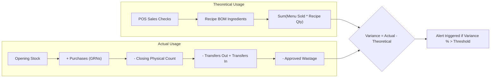
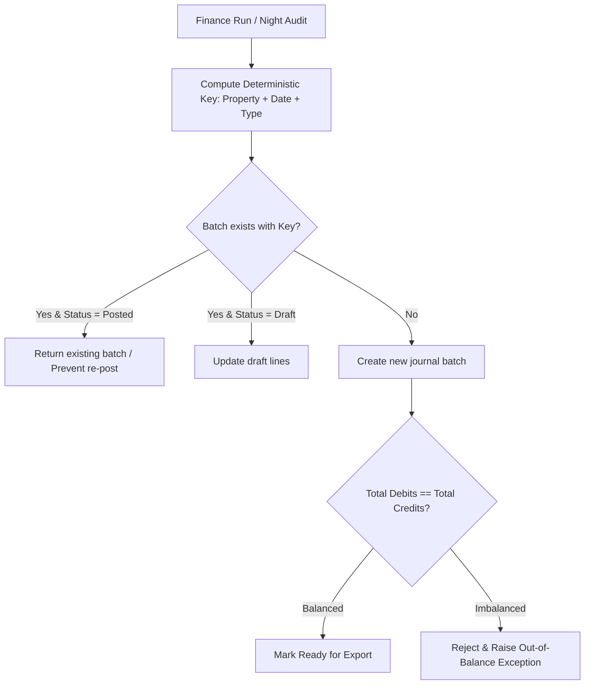

# Domain Glossary & Business Logic Reference

This glossary outlines core terms, acronyms, calculation methodologies, and operational business rules implemented across **PropertyOps Hub**.

---

## 1. Acronyms & Terminology

| Term | Definition | Context |
|---|---|---|
| **POS** | Point of Sale | Hardware/software terminal used in outlets to record orders, ring up checks, process payments, and record discounts/voids. |
| **PMS** | Property Management System | Core hotel front-office software managing room reservations, guest folios, check-ins, and direct billing. |
| **BOM** | Bill of Materials / Recipe | Quantitative breakdown of raw ingredients and preparation steps required to produce a single menu item. |
| **UoM** | Unit of Measure | Standard unit for measuring items (e.g., kg, gram, litre, ml, each, case). |
| **PO** | Purchase Order | Commercial document issued by the property purchasing team to a supplier indicating quantities and agreed prices. |
| **GRN** | Goods Receipt Note | Confirmation generated upon physical delivery and inspection of ordered goods at the receiving dock. |
| **WAC** | Weighted Average Cost | Inventory valuation method where unit cost is recomputed on every new receipt based on stock on hand and inbound cost. |
| **COGS** | Cost of Goods Sold | Direct cost attributable to the production of goods sold in the outlets over a given accounting period. |
| **GL** | General Ledger | Complete record of financial transactions over the life of the property. |
| **Folio** | Guest Folio | The individual billing account assigned to an in-house hotel guest in the PMS. |
| **Reversal** | Reversing Entry | Accounting journal that exact-cancels an erroneous previous entry; posted entries are immutable. |

---

## 2. Core Business Rules & Formulas

### Material Control & Costing Lifecycle

```mermaid
flowchart TD
    PO[1. Purchase Order Created] -->|Approved by GM| REC[2. Physical Delivery at Receiving Dock]
    REC -->|Count & Inspect| GRN[3. Goods Receipt Note Generated]
    GRN -->|Recalculate Cost| WAC[4. Weighted Average Cost Updated]
    WAC -->|Append Transaction| LEDGER[5. StockMovement Ledger (Immutable)]
    LEDGER --> STOCK[6. Current On-Hand Balance Computed]
    STOCK --> RECIPE[7. Outlet Consumption via Recipes]
    RECIPE --> VARIANCE[8. Physical Count Variance Analysis]
```

### 1. Weighted Average Cost (WAC) Formula

When goods are received via a Goods Receipt Note (GRN):

$$\text{New WAC} = \frac{(\text{Current Qty} \times \text{Old WAC}) + (\text{Received Qty} \times \text{Receipt Unit Price})}{\text{Current Qty} + \text{Received Qty}}$$

- If current stock is zero or negative, the received unit price becomes the new WAC.
- Stock movements are strictly **append-only**. Stock balance is an aggregate of movements, never directly overwritten.

---

### 2. Theoretical vs. Actual Usage & Variance



- **Theoretical Usage**:
  $$\text{Theoretical Usage} = \sum (\text{Menu Item Sold} \times \text{Recipe Ingredient Quantity})$$

- **Actual Usage**:
  $$\text{Actual Usage} = \text{Opening Stock} + \text{Purchases} - \text{Closing Stock} + \text{Net Transfers} - \text{Documented Wastage}$$

- **Variance**:
  $$\text{Variance} = \text{Actual Usage} - \text{Theoretical Usage}$$
  $$\text{Variance \%} = \frac{\text{Variance}}{\text{Theoretical Usage}} \times 100$$

---

### 3. Financial Journal Balancing & Idempotency

All generated financial journal batches adhere to double-entry accounting fundamentals:

$$\sum \text{Debits} = \sum \text{Credits}$$

#### Deterministic Idempotency Key
To ensure no double posting can ever occur when night audit or finance runs an export multiple times:

$$\text{Idempotency Key} = \text{PropertyId} + \text{BusinessDate (YYYY-MM-DD)} + \text{BatchType}$$


