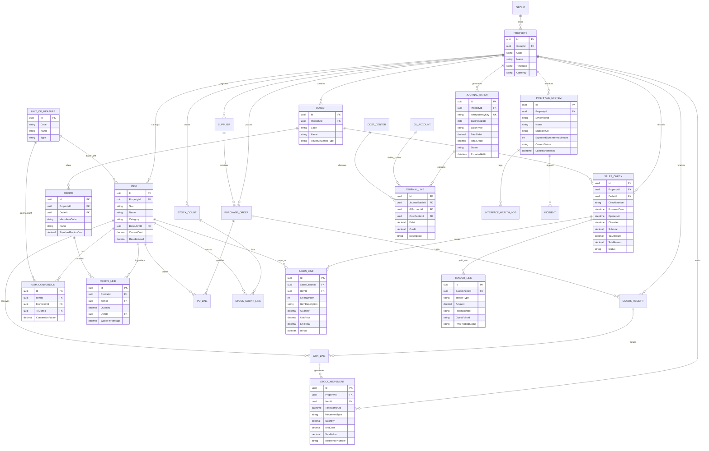

# Entity Relationship Diagram (ERD)

The data model for PropertyOps Hub enforces multi-unit tenancy (`PropertyId`), append-only movement ledgers, recipe BOM breakdowns, POS sales ingestion, and balanced double-entry accounting journals.

---

## Complete Entity Relationship Diagram

